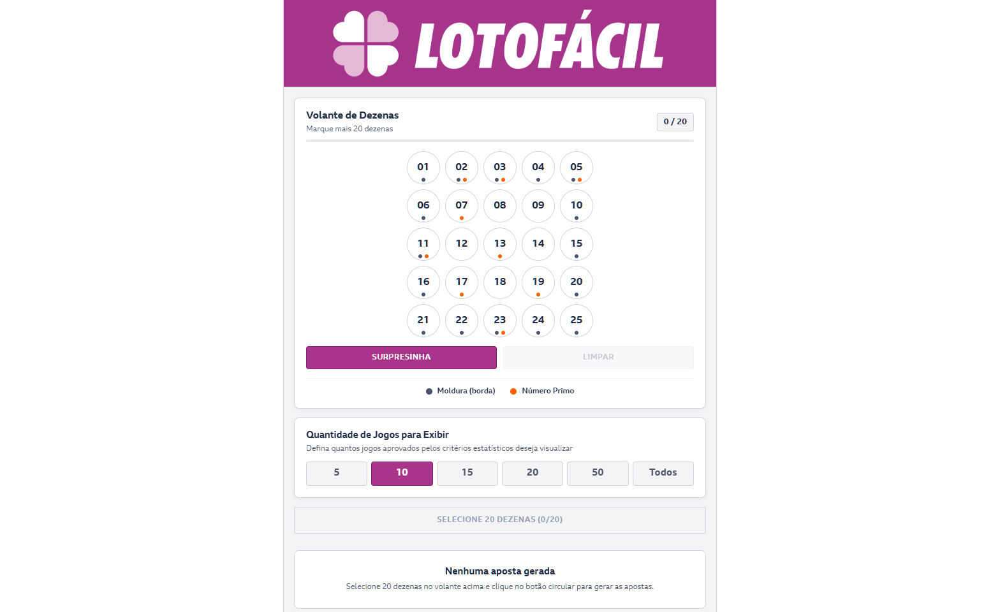
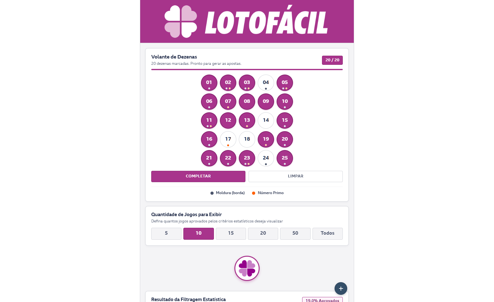
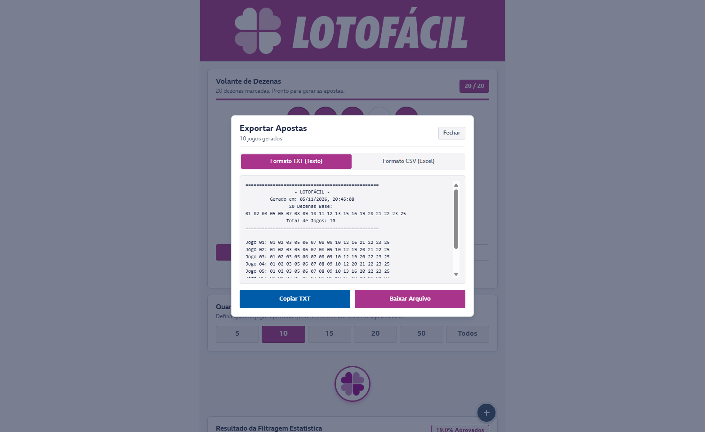

# Lotofácil • Gerador e Otimizador Combinatório de Apostas

Aplicação web e mobile-first desenvolvida em React Native (Expo Web) e TypeScript para geração, filtragem probabilística e exportação de apostas otimizadas da Lotofácil da Caixa Econômica Federal.

A aplicação está disponível e implantada na infraestrutura do domínio [lotofacil.engine.lat](https://lotofacil.engine.lat/).

```text
┌─────────────────────────────────────────────────────────────────────────────┐
│                 ARQUITETURA DE PROCESSAMENTO • LOTOFÁCIL                    │
└──────────────────────────────────────┬──────────────────────────────────────┘
                                       │
                      [ Seleção de 20 Dezenas no Volante ]
                      (Entrada Interativa: Matriz 5x5)
                                       │
                                       ▼
                   [ Motor Combinatório: C(20, 15) ]
                    (15.504 Combinações em Memória)
                                       │
                                       ▼
                  [ Pipeline de Filtragem Estatística ]
         ┌─────────────────────────────────────────────────────────┐
         │ 1. Paridade: 7 a 8 Ímpares (~62% dos Sorteios)          │
         │ 2. Faixa de Soma: Total entre 170 e 220                 │
         │ 3. Dispersão Periférica: 9 a 11 Dezenas na Moldura      │
         │ 4. Aritmética Prima: 4 a 6 Números Primos               │
         └─────────────────────────────┬───────────────────────────┘
                                       │
                                       ▼
                        [ Jogos Aprovados e Métricas ]
                 (Taxa de Aprovação, Cartões com Legendas)
                                       │
                   +-------------------+-------------------+
                   │                                       │
                   ▼                                       ▼
          [ Exportação TXT ]                      [ Exportação CSV ]
      (Formato Físico / Impressão)            (Análise Tabular / Excel)
```

## Metodologia Estatística e Algoritmo

A aplicação opera sobre a premissa de desdobramento fechado a partir de um volante reduzido de 20 dezenas, aplicando os padrões de maior frequência observados no histórico oficial de concursos da Caixa.

### 1. Cálculo Combinatório
A partir do subconjunto de 20 números escolhidos pelo usuário no universo de 25 dezenas, o motor gera o espaço amostral completo por combinação simples:

$$C(20, 15) = \frac{20!}{15! \times 5!} = 15.504 \text{ combinações}$$

O algoritmo executa recursão direta em memória (backtracking com poda antecipada) em menos de 20 milissegundos no navegador.

### 2. Filtros Estatísticos Simultâneos
Cada uma das 15.504 combinações geradas precisa atender aos 4 critérios abaixo de forma cumulativa. Apostas fora dessas faixas são descartadas:

| Filtro | Critério Operacional | Amostra Histórica |
| :--- | :--- | :--- |
| **Números Ímpares** | Entre 7 e 8 números ímpares | Concentra ~62% dos concursos oficiais |
| **Soma Total** | Somatório das 15 dezenas entre 170 e 220 | Faixa de Gauss com maior densidade de ocorrência |
| **Moldura (Borda)** | Entre 9 e 11 dezenas nas 16 posições periféricas | Padrão geométrico típico do volante 5x5 |
| **Números Primos** | Entre 4 e 6 primos dentre os 9 existentes (2, 3, 5, 7, 11, 13, 17, 19, 23) | Equilíbrio de densidade aritmética |

---

## Registros Visuais da Aplicação

### Volante Interativo de Seleção
Interface responsiva com marcação de dezenas, identificação visual de moldura/primos e atalhos de preenchimento aleatório.


### Volante Preenchido e Resumo de Filtragem
Apresentação do volante completo com 20 dezenas e acionamento do cálculo probabilístico.


### Cartões de Apostas e Métricas Individuais
Exibição das combinações aprovadas com métricas completas por bilhete (soma, contagem de ímpares, moldura e primos) e opção de cópia individual.


### Modal Informativo dos Critérios Matemáticos
Documentação embutida na interface detalhando a fundamentação estatística de cada filtro.


### Modal de Exportação e Formatação de Dados
Exportador dedicado com suporte a arquivos de texto (.txt), planilhas (.csv) e transferência instantânea para a área de transferência.


---

## Identidade Visual e Tipografia

O design system segue a cartilha cromática institucional da Lotofácil e das Loterias Caixa, projetado para legibilidade e alto contraste em telas móveis e desktops:

* **Magenta Lotofácil:** `#a8348c` (dezenas selecionadas, destaques primários e botões de ação).
* **Azul Institucional Caixa:** `#005CA9` / `#0066A6` (indicadores e botões operacionais).
* **Azul Acinzentado (Slate Blue):** `#334E68` / `#243B53` (menu flutuante FAB e halos de foco).
* **Cinza Moldura:** `#4C556C` (indicador geométrico periférico).
* **Laranja Números Primos:** `#FF6000` (indicador aritmético de dezenas primas).
* **Tipografia:** Família oficial **BBC Reith Sans** integrada nos pesos Regular, Medium, Bold e ExtraBold.
* **Diretriz de Design:** Sem uso de emojis em toda a interface, modais e arquivos exportados.

---

## Estrutura do Projeto

```text
lotofacil-app/
├── assets/
│   ├── fonts/                  # Fontes oficiais BBC Reith Sans e Caixa Std
│   └── images/                 # Marca e ícones vetorizados da Lotofácil
├── docs/
│   └── screenshots/            # Registros gráficos capturados em produção
├── src/
│   ├── components/
│   │   ├── ActionBar.tsx       # Gatilho de geração com pulso visual
│   │   ├── ExportModal.tsx     # Modal de exportação de arquivos TXT/CSV
│   │   ├── FilterControls.tsx  # Seletor de quantidade de jogos exibidos
│   │   ├── FloatingActions.tsx # Menu suspenso (FAB) para ações rápidas
│   │   ├── GameCard.tsx        # Cartão de aposta individual com métricas
│   │   ├── Header.tsx          # Cabeçalho institucional com marca oficial
│   │   ├── HowItWorksModal.tsx # Modal com fundamentação dos 4 filtros
│   │   ├── NumberGrid.tsx      # Volante 5x5 com indicadores analíticos
│   │   ├── StatsBanner.tsx     # Barra de aproveitamento estatístico
│   │   └── Toast.tsx           # Notificações visuais de feedback
│   ├── types/
│   │   └── index.ts            # Tipagens TypeScript para jogos e regras
│   └── utils/
│       └── lotofacilUtils.ts   # Motor de combinações e gerador de arquivos
├── App.tsx                     # Componente raiz e gerenciamento de estado
├── app.json                    # Metadados de configuração do Expo
├── index.ts                    # Ponto de entrada do runtime
├── metro.config.js             # Configuração do empacotador Metro
├── package.json                # Dependências e scripts do projeto
└── tsconfig.json               # Configuração do compilador TypeScript
```

---

## Execução Local

### Pré-requisitos
* Node.js 18+ instalado
* NPM ou Yarn

### Instalação
```bash
git clone https://github.com/sagihtt/lotofacil.git
cd lotofacil
npm install
```

### Inicialização em Modo Desenvolvimento
```bash
npx expo start --web
```

### Verificação de Tipagem
```bash
npx tsc --noEmit
```

### Geração do Pacote Estático de Produção
```bash
npx expo export -p web --output-dir dist
```

---

## Implantação em Servidor de Produção

A versão online em [lotofacil.engine.lat](https://lotofacil.engine.lat/) é servida por um proxy reverso Nginx com compressão gzip e cache estático para ativos otimizados:

```nginx
server {
    server_name lotofacil.engine.lat;
    root /home/engine/labs/lotofacil;
    index index.html;

    location / {
        try_files $uri $uri/ /index.html =404;
    }

    gzip on;
    gzip_types text/plain text/css application/json application/javascript text/xml application/xml image/svg+xml;

    location ~* \.(ttf|woff|woff2|png|jpg|jpeg|ico)$ {
        expires 30d;
        add_header Cache-Control "public, no-transform";
    }

    listen 443 ssl;
    ssl_certificate /etc/letsencrypt/live/lotofacil.engine.lat/fullchain.pem;
    ssl_certificate_key /etc/letsencrypt/live/lotofacil.engine.lat/privkey.pem;
}
```

---

## Licença

Este projeto está licenciado sob a Licença MIT. Consulte o arquivo [LICENSE](LICENSE) para obter mais informações.
